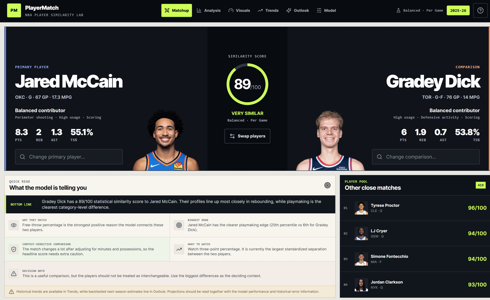

# PlayerMatch

**Interpretable NBA player similarity, historical development, and next-season forecasting.**


[Live App](https://playermatch.vercel.app) · [Research Paper](docs/PlayerMatch_Research_Paper.pdf) · [Model Card](docs/MODEL_CARD.md)

PlayerMatch is an NBA analytics project that combines player similarity, visual exploration, archetype discovery, multi-season development, and backtested next-season forecasting in one interface.

The goal is not to make the most complicated model win. PlayerMatch compares simple and more flexible approaches, evaluates them chronologically, and surfaces where the model performs well — and where it does not.

## Highlights

- **420 eligible players** in the 2025–26 player pool
- **6 seasons** of historical data from 2020–21 through 2025–26
- **1,651 player-season transitions** used for next-season forecasting
- Weighted cosine similarity across **10 standardized basketball features**
- PCA player-style maps and deterministic K-means archetypes
- Multi-season similarity and player-development analysis
- Ridge and Gradient Boosting forecasting with expanding-window validation
- Persistence-baseline comparison and untouched 2025–26 holdout evaluation
- Subgroup diagnostics, empirical error bands, automated tests, and CI

## What the app can answer

- Which NBA players have the most similar statistical profiles?
- Why does the model consider two players similar?
- How has a player's profile changed across seasons?
- How has a player-pair similarity changed over time?
- Where do players sit in a league-wide style map?
- Which statistical archetype does a player resemble?
- What does the historical data suggest for next season?
- Did the forecasting model actually beat a simple persistence baseline?

## Methods

### Player representation

PlayerMatch uses:

`PTS · REB · AST · STL · BLK · FG% · 3P% · FT% · USG% · TS%`

Each feature is standardized relative to the active league pool. I compare player profiles using weighted cosine similarity.

Preset similarity profiles include **Balanced**, **Scoring**, **Playmaking**, and **Defense**, with a custom-weight mode for sensitivity analysis.

The similarity score is a statistical-profile measure — **not player value, win impact, or interchangeability**.

### Dimensionality reduction and archetypes

- **PCA** compresses the 10-dimensional standardized player space into two dimensions for visual exploration.
- **K-means** identifies recurring statistical profiles in the full weighted feature space.
- PCA is used only for visualization; clustering is performed in the full model space.

### Next-season forecasting

Targets:

`PTS · REB · AST · TS% · USG%`

Candidate models:

- Persistence baseline
- Ridge Regression
- Gradient Boosting

Model-family selection uses **expanding-window validation**. If a simpler candidate is within **2% of the best validation MAE**, PlayerMatch chooses the simpler model. The final 2025–26 target season is held out from model-family selection.

## Held-out results

| Target | Selected model | Model MAE | Persistence MAE | Improvement |
| --- | --- | ---: | ---: | ---: |
| PTS | Ridge | 2.634 | 2.843 | 7.4% |
| REB | Ridge | 0.814 | 0.865 | 5.9% |
| AST | Ridge | 0.733 | 0.746 | 1.7% |
| TS% | Ridge | 3.107 | 3.487 | 10.9% |
| USG% | Ridge | 2.141 | 2.314 | 7.5% |

The results suggest that extra model complexity did not automatically improve next-season forecasts. Ridge remained competitive across all five targets, while the benefit over persistence varied substantially by statistic.

The greatest overall improvement was for **TS%**, but subgroup analysis showed an important limitation: among the source-season **top 10% of scorers**, persistence produced lower TS% error and the model showed negative mean signed error.

## Data

Source: **NBA Stats API** via `nba_api`

Default eligibility:

- Regular season
- Minimum 15 games
- Minimum 10 minutes per game

Generated datasets:

```text
public/players.json
public/player_history.json
public/projections.json
```

## Run locally

```powershell
npm install
npm run dev
```

Python environment:

```powershell
python -m venv .venv
.\.venv\Scripts\Activate.ps1
pip install -r requirements.txt
```

## Tests

```powershell
npm test
python -m unittest discover -s tests/python -p "test_*.py" -v
npm run build
```

## Tech stack

**Frontend:** React, Vite, JavaScript, SVG, Lucide React
**Data / ML:** Python, pandas, NumPy, scikit-learn, `nba_api`
**Methods:** weighted cosine similarity, PCA, K-means, Ridge Regression, Gradient Boosting
**Deployment:** Vercel
