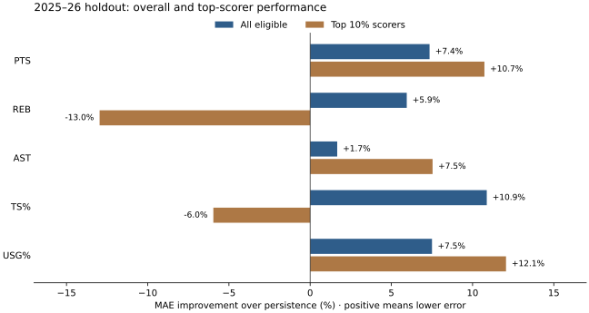

# Does a better average forecast help the NBA's top scorers?

PlayerMatch compares next-season NBA forecasts with persistence: predict that the player keeps their current-season value. This case study asks whether an overall improvement also appears among the highest-scoring players.

## Finding

On the 2025–26 holdout, Ridge lowers true-shooting-percentage MAE from **3.487 to 3.107 percentage points** overall (**10.9% improvement**, 327 players). Among the source-season top-scoring decile, it increases MAE from **2.318 to 2.456 percentage points** (**6.0% worse**, 33 players).

The top-decile mean signed TS% error is **−1.039 percentage points** (prediction minus actual). That describes average underprediction in this sample; it does not establish why it happened.



## Evidence

| Target | Unit | Group | n | Ridge MAE | Persistence MAE | Improvement |
| --- | --- | --- | ---: | ---: | ---: | ---: |
| PTS | PPG | All eligible | 327 | 2.634 | 2.843 | +7.4% |
| PTS | PPG | Top 10% scorers | 33 | 2.935 | 3.288 | +10.7% |
| REB | RPG | All eligible | 327 | 0.814 | 0.865 | +5.9% |
| REB | RPG | Top 10% scorers | 33 | 0.873 | 0.773 | -13.0% |
| AST | APG | All eligible | 327 | 0.733 | 0.746 | +1.7% |
| AST | APG | Top 10% scorers | 33 | 0.804 | 0.870 | +7.5% |
| TS% | pp | All eligible | 327 | 3.107 | 3.487 | +10.9% |
| TS% | pp | Top 10% scorers | 33 | 2.456 | 2.318 | -6.0% |
| USG% | pp | All eligible | 327 | 2.141 | 2.314 | +7.5% |
| USG% | pp | Top 10% scorers | 33 | 2.148 | 2.442 | +12.1% |

Improvement = (persistence MAE − model MAE) / persistence MAE × 100. The groups overlap: the top decile is part of the overall sample. pp means percentage points, not relative percent error.

## Method

- Source: the fixed `public/projections.json` artifact, using its holdout evaluation and scoring-level diagnostics.
- Historical inputs span 2020–21 through 2025–26, producing 1,651 eligible season-to-season transitions.
- Model-family selection uses expanding-window validation before the held-out 2025–26 target season. A 2% validation tolerance prefers simpler competitive models; Ridge was selected for all five targets.
- The top decile is defined by source-season scoring among the eligible holdout sample, not future outcomes. The holdout contains 327 eligible players, including 33 in this subgroup.
- The displayed current projections are refitted 2026–27 forecasts. They are separate from the heldout observations used in this table.

## What I would conclude

The overall result supports using Ridge as a modest improvement over persistence on this holdout. The top-scorer TS% result supports keeping the baseline visible and reviewing performance by subgroup before trusting an aggregate score. It does not justify changing model selection using this same holdout.

## Limits

This is one season's descriptive subgroup comparison, not a significance test. No causal explanation is established. Transitions require eligibility in both seasons, creating availability/survivorship bias. Injuries, trades, coaching changes, and teammate context are absent. Historical error bands are pooled residual summaries, not player-specific confidence intervals.

Code inspection found that the trainer assumes consecutive historical seasons and substitutes zeros for invalid numeric inputs. Those are robustness risks for a future ingest; the current input has contiguous seasons and passed the current-data checks. The review did not find evidence that these risks altered the committed results.

## Reproduce

```bash
python -m venv .venv
# Activate the environment for your operating system.
python -m pip install -r requirements-case-study.txt
python scripts/build_case_study.py
```

The command reads the committed artifact and writes this page, `case-study.csv`, and `case-study.svg`; it does not fetch NBA data or retrain. The CSV retains full numeric precision. See [reproducibility](REPRODUCIBILITY.md) to retrain against the cached historical input.

Input SHA-256: `12acfb2c313204dae4a9b3cc60ce81d7254f507a17683691c5d13b26a89ac8d3`.

Generated from checked-in evidence by `scripts/build_case_study.py`.
